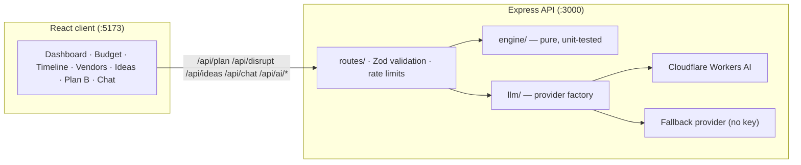

# Plan B — AI Event Planning Assistant

> _"Plan events that expect the unexpected."_

[](https://github.com/Puneet04-tech/Plan-B/actions/workflows/ci.yml)
[](LICENSE)
[](.nvmrc)
[](server/tsconfig.json)

Plan B is an event planning assistant for **weddings, birthdays and community
events** in India. It builds a realistic budget, a cue-sheet timeline and a
vendor checklist — then **replans instantly** when something goes wrong, with a
redline before/after diff.

Every rupee, date and task order comes from deterministic, unit-tested engines.
The LLM only writes creative copy and qualitative advice, always labelled
`source: "ai"` or `source: "fallback"` so the UI never hides provenance.

- Live app: <https://p-lan-b.vercel.app>
- API: <https://plan-b-ow6r.onrender.com/api/health>

---

## What it does

| Area                    | Detail                                                                                                                                                                                     |
| ----------------------- | ------------------------------------------------------------------------------------------------------------------------------------------------------------------------------------------ |
| **Budget engine**       | Per-event percentage templates that sum to exactly 100 including contingency, integer-rupee lines with the rounding remainder absorbed deliberately, per-guest catering, and a `tight / comfortable / generous` realism verdict against editable ranges. |
| **Timeline engine**     | Lead-day task templates with dependencies, a scale factor for short notice, **rush mode**, IST-safe date math (no past dates, leap-year safe), critical-path marking and human dates ("6 Nov 2026"). |
| **Vendor checklist**    | Questions to ask, documents to collect, advance-payment guidance, confirmation deadlines linked to the scheduler, estimated cost linked to budget lines, `needsBackup` flags and India-specific compliance notes. Status and contact notes persist in `localStorage`. |
| **Disruption simulator**| Five one-click scenarios — venue cancelled, rain, guests +30 %, budget cut 20 %, caterer no-show. Pure functions return a typed diff (budget changes with reasons, moved/added tasks, warnings, infeasibility). Totals always reconcile; contingency is spent before any trimming. |
| **AI features**         | Personalized ideas, a plan-grounded chat assistant, a budget optimizer with server-recomputed savings, a risk register, and post-disruption recovery tips. |
| **Accessibility**       | Skip link, semantic landmarks, ARIA tabs with arrow-key navigation, radio-group event cards, `aria-describedby` error linking, live regions, 44 px targets, table captions/scopes, colour never the only signal, `prefers-reduced-motion` respected. |

## Architecture



```
plan-b/
├── shared/types.ts        # single API contract for client + server
├── server/
│   ├── src/engine/        # budget, scheduler, vendors, disruptions (pure)
│   ├── src/llm/           # provider contract, Cloudflare + fallback providers
│   ├── src/routes/        # plan, disruptions, ai, health (thin handlers)
│   ├── src/services/      # plan assembly + grounding summaries
│   ├── src/validation/    # Zod schemas (requests and plan bundles)
│   ├── src/http/          # shared response envelope helpers
│   ├── src/lib/           # IST date helpers
│   ├── src/data/          # editable assumptions and vendor templates
│   └── tests/             # Vitest: engines, validation, routes, provider
├── client/
│   └── src/
│       ├── components/    # one component per feature surface
│       └── lib/           # api, i18n, theme, localStorage helpers
├── docs/                  # ARCHITECTURE.md, API.md
└── .github/workflows/     # CI: format, lint, typecheck, test, build
```

Read [docs/ARCHITECTURE.md](docs/ARCHITECTURE.md) for module boundaries and the
invariants the tests protect, and [docs/API.md](docs/API.md) for the endpoint
contract.

## Quick start

Requires Node.js 20+ (see `.nvmrc`).

```bash
npm ci                       # root tooling (prettier)
npm ci --prefix server       # API
npm ci --prefix client       # web app
cp .env.example server/.env  # optional — add Cloudflare credentials for live AI

npm run dev:server           # API on http://localhost:3000
npm run dev:client           # UI on http://localhost:5173 (proxies /api)
```

Without Cloudflare credentials every AI endpoint still works: it serves curated
content and labels it `source: "fallback"`.

## Scripts

All commands run from the repository root:

| Command                 | What it does                                            |
| ----------------------- | ------------------------------------------------------- |
| `npm run setup`         | Install both packages with `npm ci`                     |
| `npm run dev:server`    | API with hot reload (`tsx`)                             |
| `npm run dev:client`    | Vite dev server                                         |
| `npm run build`         | Type-check + emit the API, then build the client         |
| `npm test`              | Server and client test suites                           |
| `npm run test:coverage` | Server coverage report (v8)                             |
| `npm run typecheck`     | `tsc --noEmit` in both packages                         |
| `npm run lint`          | ESLint in both packages                                 |
| `npm run format`        | Apply Prettier                                          |
| `npm run verify`        | format check → lint → typecheck → test → build          |

## Code quality

This repository is set up so that correctness is checked by tooling, not by
review:

- **Strict TypeScript** in both packages (`strict`, `noUnusedLocals`,
  `noUnusedParameters`, `noFallthroughCasesInSwitch`, `noEmitOnError`).
- **ESLint** with the TypeScript and React rule sets, zero warnings tolerated in CI.
- **Prettier** with a checked-in config; CI fails on unformatted files.
- **115 tests** across the API and client, including HTTP-level tests against
  the real Express app, with ~94 % statement coverage on the server.
- **GitHub Actions** runs format, lint, typecheck, tests and both builds on every
  push and pull request (`.github/workflows/ci.yml`).
- **No suppressions**: no `@ts-ignore`, no disabled strictness flags, no
  `eslint-disable` for type or hook rules.

Test coverage focuses on the parts that must not drift:

| Suite                    | What it protects                                                                                   |
| ------------------------ | -------------------------------------------------------------------------------------------------- |
| `budget.test.ts`         | Templates sum to 100; lines sum to awkward totals (₹499 999); realism boundaries; typed errors      |
| `scheduler.test.ts`      | Rush mode thresholds, dependency order, past dates, month/leap-year boundaries                      |
| `disruptions.test.ts`    | All five scenarios reconcile exactly, contingency-first spending, determinism                       |
| `trim-order.test.ts`     | Low-priority lines are trimmed before venue/catering; unknown keys never jump the queue             |
| `validation.test.ts`     | Request and plan-bundle schemas, injection text, impossible calendar dates                          |
| `routes.test.ts`         | Health, plan, disrupt, ideas, chat, optimizer, risks, 400/404 envelopes                             |
| `llm-fallback.test.ts`   | Offline provider, cap enforcement, prompt sanitisation                                              |
| `dates.test.ts`          | IST conversion, leap days, roll-over dates, day arithmetic                                          |
| `client/src/lib/*.test`  | API envelope unwrapping and i18n dictionary parity                                                  |

## Core rule: the LLM never produces numbers or dates

All money, dates, task order and totals come from `server/src/engine/`. Model
output is:

1. parsed with Zod (`server/src/llm/ai-outputs.ts`),
2. cap-checked against real budget lines (`enforceCaps`),
3. labelled `source: "ai"` or `source: "fallback"`.

User text goes into a delimited `<<<DATA … >>>` block and the system prompt
states it is data, not instructions; control characters and injection-style
phrases are stripped before the call. Savings are recomputed server-side, and
risk prompts receive only facts the engine already computed.

## Gen AI service

**Cloudflare Workers AI** (`@cf/meta/llama-3.1-8b-instruct`, override with
`CLOUDFLARE_AI_MODEL`).

| Feature            | Grounding and guardrails                                                              |
| ------------------ | ------------------------------------------------------------------------------------- |
| Personalized ideas | Cost-capped server-side against budget lines; `fitsBudget` badge per idea             |
| Chat assistant     | Prompt carries the real budget lines and totals as ground truth                       |
| Budget optimizer   | Limited to categories in the plan; `suggestedCost < currentCost` enforced; savings recomputed |
| Risk analysis      | Grounded in rush mode, days available, backup-vendor flags and realism verdict        |
| Recovery tips      | Prompt forbids numbers and dates — the engine already recalculated them               |

Why Workers AI: no cold starts for chat-scale traffic, low latency, a pricing
model that suits a demo, and an OpenAI-style messages API that keeps the provider
swappable behind `server/src/llm/provider.ts`.

## Security

`helmet` with an explicit CSP, HSTS in production, a CORS origin allowlist,
100 kB body limits, per-route rate limits, Zod validation on every request and
every model response, and server-side-only API keys. Error responses never
include stack traces. Details and the reporting process are in
[SECURITY.md](SECURITY.md).

## Environment variables

| Variable                | Required    | Purpose                                                    |
| ----------------------- | ----------- | ---------------------------------------------------------- |
| `PORT`                  | no (3000)   | API port                                                   |
| `ALLOWED_ORIGIN`        | no          | Comma-separated CORS allowlist; `*` allows any origin      |
| `CLOUDFLARE_API_TOKEN`  | for live AI | Workers AI token (server-side only)                        |
| `CLOUDFLARE_ACCOUNT_ID` | for live AI | Cloudflare account id                                      |
| `CLOUDFLARE_AI_MODEL`   | no          | Override the model (`@cf/meta/llama-3.1-8b-instruct`)      |
| `VITE_API_BASE_URL`     | for deploy  | API origin used by the built client (no trailing slash)    |

## Assumptions (editable in `server/src/data/ranges.ts`)

- **Per-guest realism ranges (INR):** community 300–1500, birthday 800–3000,
  wedding 1500–6000 — starting values, not market research.
- **Rush premium:** +15 % on venue/catering when a disruption forces an
  emergency booking.
- **Trim order** when budget must be freed: promotion → activities → decor →
  sound & lights → entertainment → the remaining lines → venue → catering
  (contingency is consumed first).

## Limitations

- Vendor data is template-based, not a live marketplace.
- AI caches are in-memory per server process; nothing is persisted server-side.
- Hindi i18n covers UI labels only; engine output strings are English.
- Voice input requires the Web Speech API (Chrome, Edge, Safari).
- Risk probabilities are model estimates, not actuarial data.

## Deployment

The API runs on **Render** and the client on **Vercel**; both are described step
by step in [DEPLOYMENT.md](DEPLOYMENT.md) and driven by `render.yaml` and
`client/vercel.json`.

## 2-minute demo

1. **Landing page** — hero, feature cards, stats strip → "Start planning".
2. Wedding, Mumbai, 100 guests, ₹500 000 → **Generate Plan** → four stat cards
   with realism chip and rush awareness.
3. **Budget tab** — donut plus planned/actual tracker; no category dominates;
   catering shows per-guest cost.
4. **Timeline tab** — cue sheet with human dates, critical-path accent and
   progress bar.
5. **Vendors tab** — questions, documents, advance guidance, backup flags,
   compliance notes; check an item and reload to see it persist.
6. **Ideas / Optimizer / Risk tabs** — AI output with fit badges, server-computed
   savings and grounded risks.
7. **Plan B tab** — click *Venue cancelled* → redline diff, contingency consumed
   first, urgent task added. Click *Get recovery tips* for qualitative advice.
8. **Chat bubble** — ask "Is my catering budget enough?" and get an answer citing
   your real numbers.
9. Switch to हिं, toggle dark/light, print/export.

## License

[MIT](LICENSE).
