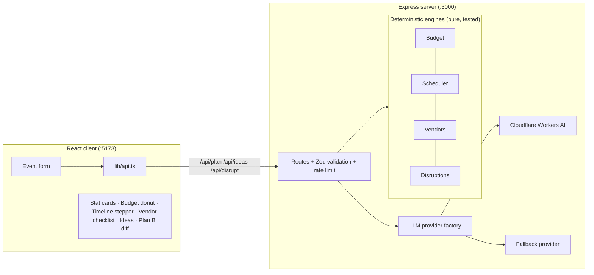

# Plan B — Event Planning Assistant

> *"Celebration meets Control Room"* — realistic plans that replan instantly when things go wrong.

## Problem statement

Create a GenAI-powered planning assistant that helps users organize weddings, birthdays, and community events with budgets, timelines, vendor checklists, and personalized ideas.

**Plan B's differentiator:** it builds a realistic plan, then **replans instantly** when something goes wrong — venue cancelled, rain, guest-count jump, budget cut, vendor no-show — with a full before/after diff.

## Core rule: the LLM never produces numbers or dates

All money, dates, task order and totals come from deterministic, unit-tested code in `server/src/engine/`. The LLM (Cloudflare Workers AI) only writes creative ideas. Its output is:

1. Validated with Zod,
2. **Cap-checked server-side** against budget lines computed by the budget engine (ideas that exceed a category cap are dropped or trimmed),
3. Labeled `source: "ai"` or `source: "fallback"` so the UI can show provenance.

The user's theme text goes into a clearly delimited `<<<DATA … >>>` block and the system prompt states it is data, not instructions; control characters and injection-like patterns are stripped.

## Architecture



```
plan-b/
├── shared/types.ts           # single API contract for client + server
├── server/
│   ├── src/
│   │   ├── engine/           # budget.ts, scheduler.ts, vendors.ts, disruptions.ts
│   │   ├── data/             # ranges.ts (assumptions), vendors.ts (checklist data)
│   │   ├── llm/              # provider.ts, cloudflare.ts, fallback.ts, factory.ts
│   │   ├── validation/       # Zod schemas (injection-safe)
│   │   └── routes/           # /api/plan /api/ideas /api/disrupt /api/health
│   └── src/app.ts            # helmet, CORS, JSON limit, rate limits
├── client/
│   └── src/
│       ├── components/       # EventForm, StatCards, ResultTabs, Budget/Timeline/Vendors/Ideas views, DisruptionPanel
│       ├── lib/              # api.ts, vendorStorage.ts, i18n.ts
│       └── index.css         # design tokens (single source of truth)
└── tests/                    # Vitest: budget, scheduler, disruptions+vendors (46 tests)
```

## Feature → scoring mapping

| Requirement       | Where                                                                                                                                                                                              |
| ----------------- | -------------------------------------------------------------------------------------------------------------------------------------------------------------------------------------------------- |
| Code quality      | Strict TS, shared types module, pure engines, no dead code                                                                                                                                         |
| Security          | helmet, strict CORS, JSON body limit, rate limits, Zod on every request + LLM output, API keys server-side only, no stack traces in errors, no `dangerouslySetInnerHTML`                           |
| Efficiency        | Only `/api/ideas` calls the LLM; engines run in ms; in-memory LRU cache with TTL on ideas; Vite proxy keeps CORS zero-cost                                                                         |
| Testing           | 46 Vitest tests on engines (template sums, exact reconciliation, rush boundaries, leap years, contingency-first trims, determinism)                                                                |
| Accessibility     | Skip link, semantic landmarks, ARIA tabs with arrow keys, radio group for event type, `aria-describedby` errors, aria-live regions, 44px touch targets, `prefers-reduced-motion`, print stylesheet |
| Problem alignment | All three event types, four core deliverables, five disruption scenarios with typed diffs                                                                                                          |

## API contract (all typed via `shared/types.ts`)

### POST /api/plan
```json
{ "eventType": "wedding", "eventDate": "2026-12-25", "city": "Mumbai", "guests": 100, "budget": 500000, "theme": "sunset garden" }
```
→ `{ success, data: { setup, budget, timeline, vendors, readiness } }` — **no LLM**, instant.

### POST /api/ideas
Same body → `{ success, data: { ideas: { themeConcept, items[] }, source: "ai" | "fallback" } }`.
Every item carries `category` (mapped to a budget line), `estimatedCost`, `fitsBudget`.

### POST /api/disrupt
`{ plan, scenario }` where scenario ∈ `venue-cancelled | rain | guest-count-up-30 | budget-cut-20 | vendor-no-show-caterer`
→ `{ success, data: { plan, diff } }` with `diff = { before, after, budgetChanges[], taskChanges[], addedTasks[], warnings[], infeasible }`. Totals always reconcile exactly.

## Setup and run

```bash
# 1. install
cd server && npm install
cd ../client && npm install

# 2. environment
cp .env.example server/.env
#   fill CLOUDFLARE_API_TOKEN + CLOUDFLARE_ACCOUNT_ID for live AI
#   (the app works without them — curated fallback ideas are used)

# 3. run (two terminals)
cd server && npm run dev        # API on :3000
cd client && npm run dev        # UI on :5173 (proxies /api)
```

## Tests

```bash
cd server
npx vitest run --root ..        # runs tests/ against src
npm run build                   # type-check + emit
```

Coverage targets engine correctness: budget templates sum to exactly 100 incl. contingency; lines sum exactly to awkward totals (₹499,999); realism verdict boundaries; rush mode triggers at 12 days but not 90; past dates rejected; dependency order preserved; month/leap-year boundaries; all five disruptions reconcile exactly with contingency-first spending and a deterministic trim order.

## Env variables

| Variable                | Required           | Purpose                                                   |
| ----------------------- | ------------------ | --------------------------------------------------------- |
| `PORT`                  | no (default 3000)  | API port                                                  |
| `ALLOWED_ORIGIN`        | no (default :5173) | CORS origin                                               |
| `CLOUDFLARE_API_TOKEN`  | for live AI        | Workers AI token (server-side only)                       |
| `CLOUDFLARE_ACCOUNT_ID` | for live AI        | Cloudflare account id                                     |
| `CLOUDFLARE_AI_MODEL`   | no                 | Override model (default `@cf/meta/llama-3.1-8b-instruct`) |

## Assumptions (editable in `server/src/data/ranges.ts`)

- **Per-guest realism ranges (INR):** community 300–1500, birthday 800–3000, wedding 1500–6000. These drive the tight/comfortable/generous verdict and are deliberately starting values.
- **Rush premium:** +15% on venue/catering when a disruption forces an emergency booking.
- **Trim order** when budget must be freed: promotion → activities → decor → soundLights → entertainment (contingency is consumed first, before any trim).

## Limitations

- Vendor data is template-based, not a live vendor marketplace.
- Realism ranges are assumptions, not market research.
- The idea cache is in-memory per server process (no persistence).
- Hindi i18n covers labels only; engine output strings are English.

## 2-minute demo script

1. Open the app → wedding, Mumbai, 100 guests, ₹500,000, ~2 months out → **Generate Plan**.
2. Point at the four stat cards: budget, per-guest realism chip, days-left, readiness.
3. **Budget tab:** donut + table; no category dominates; catering shows per-guest.
4. **Timeline tab:** sorted stepper, dates like "6 Nov 2026", critical path badge, check off a task → progress bar.
5. **Vendors tab:** questions, documents, advance guidance, backup flags on venue/caterer, community compliance notes.
6. **Ideas tab:** AI ideas with fit badges (or "offline suggestions" without a key).
7. **Plan B tab (the hero):** click *Venue cancelled* → before/after diff: contingency consumed first, rush premium, "Book replacement venue" task added within 2 days, warnings if infeasible. Click *Budget cut 20%* → exactly what was cut, by how much, in a documented order.
8. Switch to Hindi, hit Print/Export, done.
